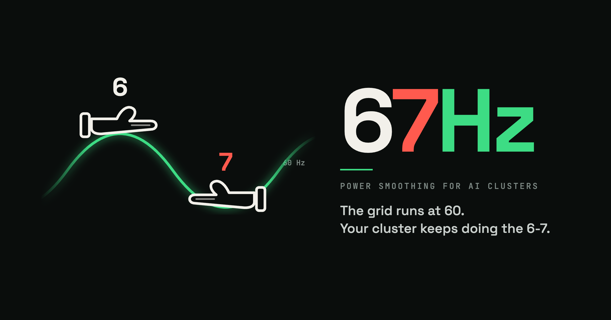

# GridSafe (`67Hz`)

Verified large-load interconnection controller synthesis for AI training clusters, built at the Gemini 4 NYC Hackathon.

- See `SPEC.md` for the full build plan.
- Run `make fetch-specs` to download the real utility interconnection PDFs listed in `specs/SOURCES.md`.
- Run `make test` and `make eval` to execute the test suite and evaluation harness.
- Run `make run` for the single-port app (UI API + agent API + frontend).

## How the managed agents are used

Two saved Antigravity agents talk only through our host `message_agent` bridge (Interactions API). No API keys enter any sandbox. The deterministic checker on the host is ground truth.

### `gridsafe-engineer` (`gemini-4-hydrogen`)

| Skill / tool | Runs inside the agent sandbox | Runs on our backend (host) |
| --- | --- | --- |
| `read-rulebook` (custom function) | Agent only *calls* the function | Neon Reader (`reader/extract.py`) parses PDF/page images |
| `verify_constraint` (custom function) | Agent only *calls* the function | Decisions API Verifier (`reader/verify.py`) |
| `evolve-controller` | May inspect mounted repo code / draft text | Host `evolve/loop.py` (B3 seed + Hydrogen mutations + sandbox checker) produces the real controller |
| `certify` | May draft certificate text | Host re-runs checker/tests before any compliance claim |
| `message_agent` | Emits the function call | Host creates/continues a `gridsafe-hardener` interaction and returns the reply |
| `code_execution` | Sandbox Python + numpy on mounted `/workspace/repo` | Never trusted alone for compliance |

### `gridsafe-hardener` (`gemini-4-carbon`)

| Skill / tool | Runs inside the agent sandbox | Runs on our backend (host) |
| --- | --- | --- |
| `red-team` | Proposes adversarial workloads / short numpy probes | Host re-checks every claimed counterexample with `rules/checker.py` |
| `analyze-failure` | Explains a break and suggests a fix hint | Host confirms measured margins; engineer fix is re-evolved on host |
| `message_agent` | May call back to the engineer | Host bridges the reply; logs JSON to `eval/agent_threads/` |
| `code_execution` | Optional short attack probes | Rejected if the host checker does not reproduce the break |

Background hardening (`make harden`) and UI `POST /api/agents/harden` both use this bridge. Set `managed_agent.enable_agents: false` in `config/models.yaml` to keep the local evolve path only.
