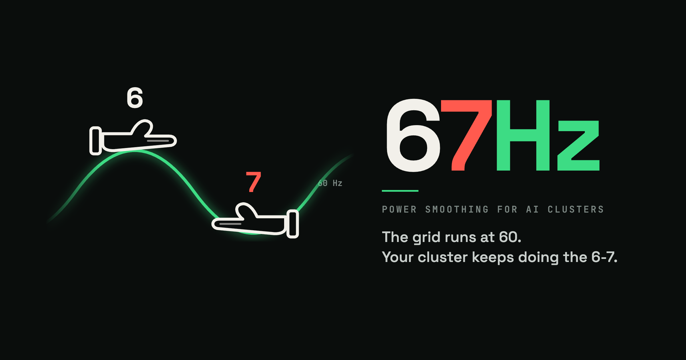

# GridSafe details

Long-form README content. Judges: start with [README.md](../README.md). Numbers: [RESULTS.md](../RESULTS.md), [FAILURES.md](../FAILURES.md), [NUMBERS.md](NUMBERS.md).



# GridSafe (`67Hz`)

GridSafe turns a utility large-load interconnection rulebook (PDF, photo, or handwritten page) into a power-smoothing controller for an AI training cluster, verifies every extracted limit against its source page, evolves the controller against a deterministic checker, attacks its own result, and returns a compliant controller with a certificate — or an explicit refusal. Built today at the Gemini 4 NYC Hackathon with AI coding agents in Cursor.

## One-command run

```bash
make demo
```

Serves the built UI + API on [http://127.0.0.1:8000](http://127.0.0.1:8000) with **no auto-reload**. Then `make demo-check` to verify the API key, models, Decisions API, both managed agents, a saved replay, and the UI build.

Other useful targets: `make test`, `make eval`, `make eval-final SEED=20261121`, `make eval-live SEED=<n>`, `make report`, `make harden` / `make harden-pause` / `make harden-resume`.

## Model → job (Gemini 4 capability each job depends on)

| Job | Model / agent | Gemini 4 capability (see `docs/API_NOTES.md`) |
| --- | --- | --- |
| Reader | `gemini-4-neon` | Interactions API + document/image input with page slicing & structured JSON schema out |
| Verifier | `gemini-decision-1` | Decisions API (`v1beta`) calibrated `noul` yes/no on the cited page image (zero output tokens) |
| Designer / Engineer | `gemini-4-hydrogen` → saved agent `gridsafe-engineer` | Fast parallel mutations via Interactions API; Antigravity managed agent + custom functions |
| Red-team / Hardener | `gemini-4-carbon` → saved agent `gridsafe-hardener` | Background Antigravity agent (`agent_config`) for adversarial workloads |
| Stock baseline B2 | `antigravity-preview-09-2026` | Stock managed agent, **no** skills/hooks/functions/checker |

Never drop below two Gemini 4 models with distinct jobs. Checker, shaft sim, and certificate math are plain Python + numpy — never AI.

## Built today

- All application code in this repo (Python backend, Vite/React UI, evolve loop, checker, agents bridge, eval harness).
- Written today with AI coding agents in Cursor at the Gemini 4 NYC Hackathon.
- Saved managed agents `gridsafe-engineer` / `gridsafe-hardener`, skills under `.agents/skills/`, and host `message_agent` bridge.

## Not built by us

| Piece | What it is |
| --- | --- |
| `google-genai` | Google Gemini Python SDK (Interactions, Decisions, Agents APIs) |
| Gemini 4 models + Decisions API + Antigravity | Google / DeepMind hosted models and managed-agent runtime |
| FastAPI, uvicorn, pydantic, python-dotenv, PyYAML | Web/server utilities |
| numpy, scipy | Numerics (scipy is backend/validation only; sandbox is numpy-only) |
| PyMuPDF | PDF page rendering (backend only) |
| pytest, httpx | Tests / HTTP |
| Vite, React, TypeScript, Tailwind, shadcn/ui, Motion, lucide-react, Geist fonts | Frontend stack |
| IEEE First Benchmark Model parameters | Published SSR shaft parameters in `config/fbm.yaml` (IEEE Trans. PAS, 1977) — not invented |
| Utility rulebook PDFs | Public documents listed in `specs/SOURCES.md` (CAISO, ESIG, LIPA/PSEG, IESO, MISO, arXiv survey) |

## How the managed agents are used

Two saved Antigravity agents talk only through our host `message_agent` bridge (Interactions API). No API keys enter any sandbox. The deterministic checker on the host is ground truth.

### `gridsafe-engineer` (`gemini-4-hydrogen`)

| Skill / tool | Runs inside the agent sandbox | Runs on our backend (host) |
| --- | --- | --- |
| `read-rulebook` (custom function) | Agent only *calls* the function | Neon Reader (`reader/extract.py`) parses PDF/page images |
| `verify_constraint` (custom function) | Agent only *calls* the function | Decisions API Verifier (`reader/verify.py`) |
| `evolve-controller` | May inspect mounted repo code / draft text | Host `evolve/loop.py` (B3 seed + Hydrogen mutations + sandbox checker) produces the real controller |
| `certify` | May draft certificate text | Host re-runs checker/tests before any compliance claim |
| `message_agent` | Emits the function call | Host creates/continues a `gridsafe-hardener` interaction and returns the reply |
| `code_execution` | Sandbox Python + numpy on mounted `/workspace/repo` | Never trusted alone for compliance |

### `gridsafe-hardener` (`gemini-4-carbon`)

| Skill / tool | Runs inside the agent sandbox | Runs on our backend (host) |
| --- | --- | --- |
| `red-team` | Proposes adversarial workloads / short numpy probes | Host re-checks every claimed counterexample with `rules/checker.py` |
| `analyze-failure` | Explains a break and suggests a fix hint | Host confirms measured margins; engineer fix is re-evolved on host |
| `message_agent` | May call back to the engineer | Host bridges the reply; logs JSON to `eval/agent_threads/` |
| `code_execution` | Optional short attack probes | Rejected if the host checker does not reproduce the break |

Background hardening (`make harden`) and UI `POST /api/agents/harden` both use this bridge. Set `managed_agent.enable_agents: false` in `config/models.yaml` to keep the local evolve path only. If hardener turns time out, `make harden-pause` / `make harden-resume` (or `touch`/`rm` `eval/attacks/HARDEN_PAUSE`).

## Results & failures

- **[RESULTS.md](../RESULTS.md)** — pass rates with Wilson intervals, cost, extraction, degradation, hardening (generated by `make report` from saved JSON only).
- **[FAILURES.md](../FAILURES.md)** — real failure modes found during the build, with before/after numbers from runs in this repo.
- **[docs/NUMBERS.md](NUMBERS.md)** — twelve presenter-quote numbers with file + command provenance.

## Specs

- Run `make fetch-specs` to download the real utility interconnection PDFs listed in `specs/SOURCES.md`.
- Full build plan: `SPEC.md`. API probe notes: `docs/API_NOTES.md`.
