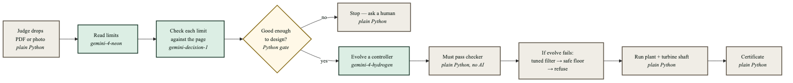
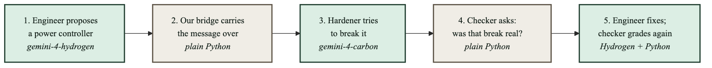
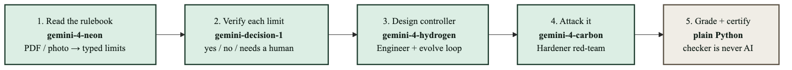

# GridSafe flow (judge pitch, ~3 min)

Local loop is **built**. Agent bridge is **built**. Continuous hardening log (`eval/attacks/`) and Baseline B2 are **planned, not built**.

**Say this out loud:** We read a utility PDF, verify every number against the page, evolve a controller, attack it with a second agent, and only trust the answer if plain-Python math says pass.

## 1. Main path

- **Green boxes = Gemini.** **Tan boxes = our code.** Yellow diamond = go / stop.
- Drop a PDF or camera photo → Neon extracts limits → Decision model verifies each one → if anything is shaky we refuse → Hydrogen evolves a controller → Python checker must pass → fallback ladder if needed → shaft sim → certificate.

## 2. How the two agents talk

**Pitch script (memorize this):**

1. **Engineer** (Hydrogen) invents a controller.
2. Agents **can’t call each other**, so **our bridge** (plain Python) carries the message.
3. **Hardener** (Carbon) tries to break that controller.
4. **Our checker** (plain Python) decides if the break is real — we never trust the AI alone.
5. Engineer **fixes**; checker **grades again**.

## 3. Same style, all Gemini models we use

| Job | Model | Agent? |
| --- | --- | --- |
| Read rulebook | `gemini-4-neon` | No — backend Reader |
| Verify each limit | `gemini-decision-1` | No — backend Verifier |
| Design / Engineer | `gemini-4-hydrogen` | Yes — `gridsafe-engineer` |
| Attack / Hardener | `gemini-4-carbon` | Yes — `gridsafe-hardener` |
| Checker + sim + certificate | plain Python | Never AI |

## 4. Likely judge questions

1. **Why not one model call?** B0 (one Neon shot, no checker) was **32/33** presets but worse on cost (e.g. ERCOT **18.2% TP / 4.3% OH** vs us **13.8% / 3.5%**); held-out IESO B0 was **0/4** until evolve got checker feedback (**4/4**, **2.9% OH**).
2. **Why not a plain tuned filter?** B3: **33/33** presets but higher loss than us, and only **15/20** on unseen `lipa` vs our **19/20**.
3. **Unreadable photo?** Severity-4: Verifier `page_readable_p=0.1314` → **Needs human review** (threshold **0.60**), not a confident wrong answer.
4. **Simulator right?** IEEE FBM modes within **0.0143%** of published Hz; energy residual **~6.7e-15** (gate **1e-12**); eval **~19 ms**.
5. **Where it still fails?** `lipa` best controller **19/20** Rand20 (**−4.85%** band); seed 101 fell back to safe floor (**41.4% OH**). Extraction **P=0.679 / R=1.000**.
6. **How agents talk?** Bridge + Interactions API; checker re-checks every claim. `eval/attacks/` tally + B2: **planned, not built**.
